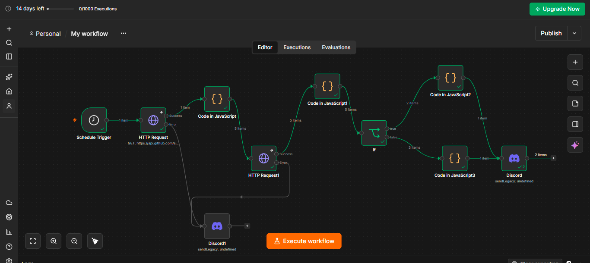
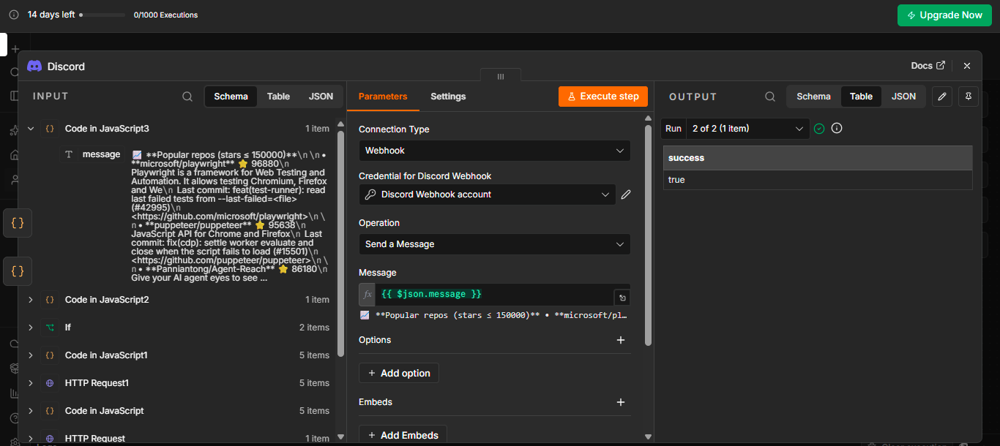
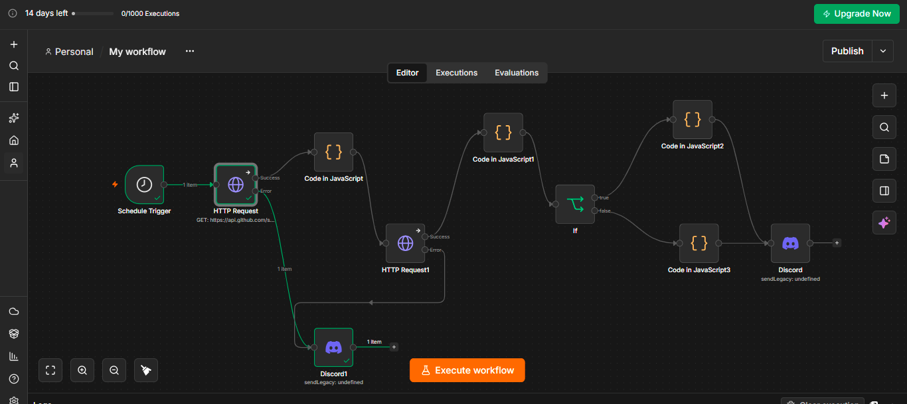
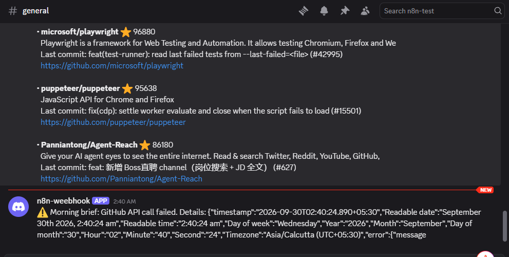
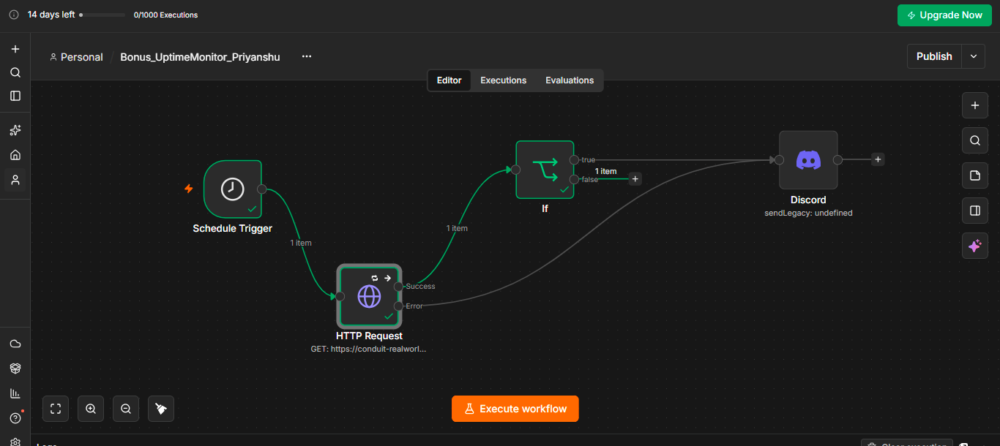
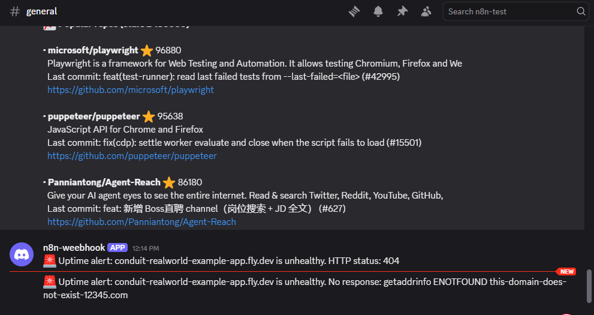

# Automation & QA Developer - Take-Home Assessment

Submitted by: **Priyanshu Ojha**

## What is in this repo

| File | What it is |
|---|---|
| `Task1_QA_Report_Priyanshu.pdf` | Task 1: QA & debug report (bug table + root-cause analysis) |
| `Task2_Workflow_Priyanshu.json` | Task 2: exported n8n workflow |
| `Bonus_UptimeMonitor_Priyanshu.json` | Bonus: uptime monitor workflow |
| `screenshots/` | Task 2 canvas, successful output, error-path test; Bonus canvas and alert |

Loom walkthrough: **https://drive.google.com/file/d/1Etpsx_2DiXMepLtR99d_WjrPvorXB8gR/view?usp=sharing**

---

## Task 1 - QA & Debug Report

- **App tested:** Conduit (RealWorld) public live demo, https://conduit-realworld-example-app.fly.dev/
- **Method:** manual exploratory testing of sign-up, login, logout and the home feed, with browser DevTools (Console and Network).
- **Result:** 5 issues (1 Critical, 1 High, 1 Medium, 2 Low). Full table with steps, expected vs actual, severity and suspected cause is in the PDF.
- **Root-cause analysis:** Bug #3 - an account created with a 1-character password can never log in, because the login field requires 5+ characters while sign-up and the server enforce no length rule.

---

## Task 2 - n8n API Integration Workflow ("Morning brief")

**What it does:** every hour it fetches the most-starred GitHub repos for the topic `automation`, keeps the top 5, looks up each repo's latest commit, splits them into **HOT** and **Popular** by star count, and posts one digest per group to a Discord channel. If an API call fails, it sends an alert instead of failing silently.

**Flow:** Schedule Trigger -> HTTP Request (GitHub search) -> Code (top 5) -> HTTP Request1 (latest commit) -> Code1 (merge) -> IF (stars > 150000) -> Code2 (HOT digest) / Code3 (Popular digest) -> Discord. Both HTTP nodes also have an error output that goes to Discord1 (failure alert).

### APIs used and why
- **GitHub REST API, `/search/repositories`** - free, no API key needed, and returns structured data (stars, description, URL), so it is easy to filter and sort.
- **GitHub REST API, `/repos/{owner}/{repo}/commits?per_page=1`** - second endpoint of the same API, used to enrich each repo with its latest commit message and date (shows whether the project is active).
- **Discord webhook** - simplest free output: one webhook URL, no bot or OAuth setup.

### What the transformation does
- `Code in JavaScript` sorts the 10 search results by stars, keeps the top 5, and keeps only `name`, `stars`, `url` and `description` (`No description` if it is null).
- `Code in JavaScript1` merges the latest commit message and date back into each repo (the second HTTP node only returns commit data, so the repo fields have to be re-attached).
- The IF node routes repos with more than 150000 stars to **HOT** and the rest to **Popular**. The threshold was chosen from the real data so that both branches get items.
- `Code in JavaScript2` and `Code in JavaScript3` turn each group into a single digest message (descriptions cut to 100 characters to stay under Discord's message limit).

### How the error path behaves
Both HTTP Request nodes use **On Error -> Continue (using error output)**. If a call fails, the workflow does not stop; the error output goes to a Discord node that posts "GitHub API call failed" with the error message. I tested this by deliberately breaking the URL: only the error path ran, the alert arrived in Discord, and the workflow did not crash.

### Credentials
The Discord webhook URL is stored in the n8n **Credentials** store. It is not hard-coded in any node and does not appear in the exported JSON.

### Screenshots

### How to run it
1. In n8n, choose **Import from file** and select `Task2_Workflow_Priyanshu.json`.
2. Create a **Discord Webhook** credential with your own webhook URL and select it in both Discord nodes.
3. Click **Execute workflow**. (Publish the workflow to make the hourly schedule run.)

### Known limitations
- GitHub's unauthenticated rate limit is low; a GitHub token credential and Retry On Fail would make it more robust.
- I tested by running the workflow manually; it is not published, so the hourly schedule is not running.

---

## Bonus - Uptime Monitor

Workflow file: `Bonus_UptimeMonitor_Priyanshu.json`. It monitors the app tested in Task 1 (https://conduit-realworld-example-app.fly.dev/) and alerts the same Discord channel used in Task 2.

**Flow:** Schedule Trigger (every 5 minutes) -> HTTP Request (GET the app) -> IF (`statusCode` is not 200) -> Discord alert. The HTTP Request's error output also goes to the same Discord node.

- **Non-200 status:** *Never Error* is on, so 4xx/5xx responses are returned with their `statusCode` instead of failing the node. The IF node sends anything other than 200 to Discord (`HTTP status: <code>`).
- **App unreachable:** the HTTP node uses *Continue (using error output)*, so a failed connection goes to Discord as `No response: <error message>`.
- **Retry logic:** *Retry On Fail* is on (3 tries) so a single slow or failed request does not trigger a false alert.
- **Tested:** a URL returning 404 produced an `HTTP status: 404` alert; a non-existent domain produced a `No response: getaddrinfo ENOTFOUND ...` alert; the real app URL produced no alert.
- **Not implemented:** response-time tracking and a daily summary.
- The workflow is not published (every 5 minutes is 288 runs a day, which would use up the trial's execution limit); I tested it by running it manually.

